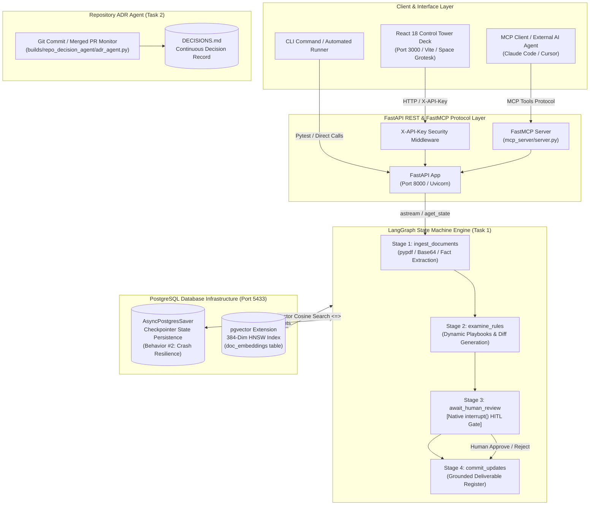

# Task 4 System Architecture Diagram: DocTask

This document presents the full-stack system architecture of the **DocTask Autonomous Platform** (Task 1 & Task 2).

---

## 🏗️ End-to-End System Architecture

---

## 📌 Architectural Layer Breakdown

### 1. Client Layer (`frontend/`)
- Built with React 18, Vite, and custom CSS design system.
- Displays 4 visible workflow stages, document ingestion dock, 2-option human review cards (`✖ Reject` / `✓ Approve`), top sticky bulk controls, and stage telemetry analytics.

### 2. API & MCP Layer (`backend/app/api/` & `backend/app/mcp_server/`)
- **FastAPI REST API**: Endpoints for `/ingest`, `/pending-reviews`, `/approve`, `/runs/{thread_id}/status`, `/runs/{thread_id}/export`, `/vector-search`.
- **FastMCP Protocol**: Standardized machine interface exposing `trigger_pipeline`, `submit_approval`, and `export_report` for programmatic driving.

### 3. LangGraph Orchestration Layer (`backend/app/agents/graph.py`)
- Stateful cyclic workflow graph with 4 distinct nodes.
- Native `interrupt()` gate pauses execution until human operators commit item decisions.

### 4. PostgreSQL Storage Infrastructure (`docker-compose.yml`)
- PostgreSQL v16 on Port `5433` with `pgvector` extension.
- **`AsyncPostgresSaver`**: Survives process kills and restarts cleanly.
- **`doc_embeddings`**: HNSW index for fast 384-dimensional cosine distance searches.

### 5. Task 2 Repository ADR Agent (`builds/repo_decision_agent/`)
- Watches git commits, filters architectural decisions, updates status lines (accepted/superseded), and writes continuous decision records to `DECISIONS.md`.
