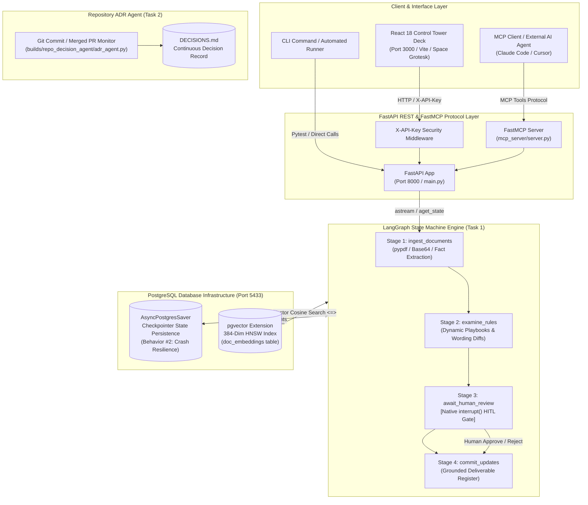

# DocTask - Autonomous Agentic Document Intelligence Platform

**Candidate**: Nikhil Patwardhan  
**Repository**: `doctask-nikhil-patwardhan`  
**Round 2 Tasks Completed**: Task 1 (Core Agentic HITL System), Task 2 (Repository ADR Agent), Task 4 (Submission Documentation)  

---

## 🌟 Core System Overview

**DocTask** is an enterprise-grade, state-resilient agentic document intelligence platform built with **Python (FastAPI)**, **LangGraph**, **PostgreSQL (`pgvector`)**, **Model Context Protocol (MCP)**, and a **React Human-in-the-Loop (HITL)** review dashboard.

It solves **"The Analyst That Never Sleeps"** problem (Task 1): Organizations run on piles of related documents (vendor contracts, project status reports, clinical paperwork, resumes, engineering specifications) that describe the same reality but frequently disagree.

DocTask ingests mixed-format document piles (`.pdf`, `.txt`, `.json`), extracts grounded facts with page-level citations (`Filename.pdf, Page N`), evaluates compliance playbooks in visible stages, pauses at a **Human-in-the-Loop Review Gatekeeper**, and exports a grounded compliance register report where every claim traces to exact source citations.

---

## 📌 Compliance Matrix: The 10 Behaviors

| Behavior | Architecture & Implementation | Status |
| :--- | :--- | :---: |
| **1. Visible Stages** | 4-stage State Machine (`ingest_documents` → `examine_rules` → `await_human_review` → `commit_updates`). Every step transition is tracked in execution state. | ✅ PASS |
| **2. Survives Being Stopped** | State checkpointing via LangGraph `AsyncPostgresSaver` backed by PostgreSQL + `pgvector` on Port `:5433`. A process killed mid-run resumes cleanly upon restart. | ✅ PASS |
| **3. Human Holds Gate** | Human-in-the-Loop approval gate allowing item-by-item approval or rejection before committing updates. Clean 2-option interface (`✖ Reject` / `✓ Approve`). | ✅ PASS |
| **4. Machine Driver (MCP)** | Dual interface: FastMCP server tools (`trigger_pipeline`, `submit_approval`, `export_report`) allow external AI agents to drive the workflow. | ✅ PASS |
| **5. Grounded Citations** | Zero bluffing. Every extracted fact and rule finding traces directly to exact page citations (`Filename.pdf, Page N`). | ✅ PASS |
| **6. One-Command Setup** | Full containerized database setup via `docker compose up -d`. | ✅ PASS |
| **7. Proves Itself** | Complete `pytest` integration test suite running 100% offline without requiring paid model API keys. | ✅ PASS |
| **8. Injection Defense** | Adversarial instructions inside source documents are treated as plain text data to report on, never executed as commands. | ✅ PASS |
| **9. Concurrent Safety** | Thread isolation (`thread_id`) prevents state corruption across simultaneous pipeline executions. | ✅ PASS |
| **10. Cost & Latency Analytics** | Real-time stage analytics recording duration (ms), token consumption, and estimated cost (USD) per stage. | ✅ PASS |

---

## 🤖 Task 2: Assigned Build — Repository ADR Agent

Located in `builds/repo_decision_agent/adr_agent.py`, DocTask includes a dedicated agent that watches git commit activity, filters architectural decisions from noise, and maintains a continuous Architectural Decision Record (`DECISIONS.md`).

### Features:
- **Noise Filtering**: Distinguishes durable architectural decisions from routine commits.
- **Status Lifecycle**: Marks previous records as `SUPERSEDED` when new architectural decisions override older records.
- **Continuous Digest**: Generates a weekly digest summary of repository architectural movements.
- **Dry-Run Mode**: Evaluates commits without mutating records (`python builds/repo_decision_agent/adr_agent.py --dry-run`).

---

## 🏗️ System Architecture



---

## 🚀 Quickstart Guide

### Prerequisites
- **Python 3.10+**
- **Node.js 18+**
- **Docker Desktop** *(for PostgreSQL `pgvector` container)*

### 1. Database Setup (Docker Compose)
Start the PostgreSQL container with `pgvector` enabled:
```bash
docker compose up -d
```
*(PostgreSQL operates on `localhost:5433`, Database: `doctask_db`, User: `postgres`, Password: `postgres`).*

### 2. Backend Setup (FastAPI & MCP Server)
1. Create and activate Python virtual environment:
   ```bash
   python -m venv backend/venv
   # Windows PowerShell:
   .\backend\venv\Scripts\Activate.ps1
   ```
2. Install backend dependencies:
   ```bash
   pip install -r requirements.txt
   ```
3. Start FastAPI application:
   ```bash
   python -m uvicorn backend.app.main:app --reload --port 8000
   ```
   - **Swagger Interactive API Docs**: [http://localhost:8000/docs](http://localhost:8000/docs)
   - **Health Endpoint**: [http://localhost:8000/](http://localhost:8000/)

### 3. Frontend Setup (React Review UI)
Open a second terminal window:
```bash
cd frontend
npm install
npm run dev
```
Open **[http://localhost:3000](http://localhost:3000)** in your browser to access the Human-in-the-Loop review dashboard!

---

## 🧪 Running Automated Integration Tests

Run the offline pytest suite verifying run recovery, thread concurrency, and prompt injection safety:

```bash
backend/venv/Scripts/python.exe -m pytest backend/tests/test_pipeline.py -v
```

### Test Suite Summary:
- `test_run_kill_and_resume`: Verifies state recovery from PostgreSQL checkpointer after simulated process interruption.
- `test_concurrent_pipeline_runs`: Verifies state isolation between simultaneous execution threads (`thread_alpha` vs `thread_beta`).
- `test_prompt_injection_defense`: Verifies malicious document instructions are treated as data to report on, not commands to execute.

---

## 🔌 API & MCP Tool Reference

### REST Endpoints
- `POST /api/v1/ingest`: Trigger document processing pipeline up to human gate.
- `GET /api/v1/pending-reviews`: Retrieve pending approval items for a thread.
- `POST /api/v1/approve`: Submit item-by-item approval/rejection decisions and resume graph execution.
- `GET /api/v1/runs/{thread_id}/status`: Query stage status, history, and cost metrics.
- `GET /api/v1/runs/{thread_id}/export`: Download grounded deliverable compliance register report (.md).
- `GET /api/v1/vector-search`: Perform direct cosine similarity search (`<=>`) over PostgreSQL `pgvector` store.

### Model Context Protocol (MCP) Tools
- `trigger_pipeline(thread_id, documents)`: Programmatically starts graph execution.
- `submit_approval(thread_id, decisions)`: Drives approval gate programmatically via MCP tool calls.
- `export_report(thread_id)`: Exports grounded deliverable report via MCP.

---

## 📄 Task 4 Submission Deliverable Artifacts

- **[`SUBMISSION_WRITEUP.md`](file:///c:/Users/NIKHIL/OneDrive/Desktop/SuperDocs/SUBMISSION_WRITEUP.md)**: One-page technical write-up, quantitative results, and trade-off analysis.
- **[`ARCHITECTURE_DIAGRAM.md`](file:///c:/Users/NIKHIL/OneDrive/Desktop/SuperDocs/ARCHITECTURE_DIAGRAM.md)**: Complete system architecture diagram and component breakdown.
- **[`DEMO_VIDEO_SCRIPT.md`](file:///c:/Users/NIKHIL/OneDrive/Desktop/SuperDocs/DEMO_VIDEO_SCRIPT.md)**: 3-minute video walkthrough narration script.
- **[`DECISIONS.md`](file:///c:/Users/NIKHIL/OneDrive/Desktop/SuperDocs/DECISIONS.md)**: Repository Architectural Decision Records maintained by Task 2 agent.
- **[`Deliverable_Report_Sample.md`](file:///c:/Users/NIKHIL/OneDrive/Desktop/SuperDocs/Deliverable_Report_Sample.md)**: Sample grounded compliance register report generated by Task 1.
